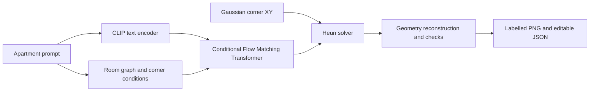

# Model architecture

The production checkpoint instantiates `FlowMatchingPlanTransformer` in `model.py`. Its saved architecture arguments specify width 512, eight heads of dimension 64, two room-node layers, and four corner layers. The release contains 48,229,284 model tensor elements. The production loader applies the checkpoint state dict and sets evaluation mode. [Model definition](../original_source/Text2Floorplan/model.py) · [Release checkpoint manifest](../original_source/Text2Floorplan/checkpoints/manifest.json)

## Inputs and transformer

| Input | Production representation | Role |
| --- | --- | --- |
| CLIP and timestep | 768-dimensional pooled text embedding and scalar noise level σ | The projected text and timestep embeddings combine into the condition used by adaptive layer normalization in the corner blocks |
| Room topology | Up to 20 padded nodes, 61 features per node | One-hot room slot and type plus random-walk and Laplacian graph encodings. Masked node attention captures connectivity |
| Corner structure | Up to 128 padded corner tokens, 52 stored features per token | Contains XY, room-centroid XY, room identity and corner identity. The model projects geometry derived from the coordinates and ring position and gathers each corner's room embedding |
| Attention structure | Validity, room, connection and global masks, plus next-corner mapping | Limits attention to relevant neighbours and supplies valid polygon edges for refinement |

The prompt supplies apartment size and requested counts. The rule sampler creates the graph and samples room corner counts from the committed priors. The runtime passes the model's optional explicit room-area tensor as `None`. Size informs the text and physical-scale recovery. [Inference conditions](../original_source/Text2Floorplan/data_generation.py) · [Inference runtime](../original_source/Text2Floorplan/inference_runtime.py)

## Geometry heads and reconstruction

The continuous head predicts a 2D velocity at each valid corner. The discrete head uses an estimate of clean geometry, its edge features and room conditions to predict 16 coordinate bits. The solver moves XY through a decreasing σ schedule, uses the discrete predictions near σ = 0, and supplies polygon coordinates to the reconstruction code.

After reconstruction, the original pipeline restores aspect and physical scale, repairs boundaries, places openings, builds walls and railings, and checks geometry and clear floor areas. Those operations are part of the production inference output. [Production pipeline](../original_source/Text2Floorplan/pipeline_generate.py) · [Backend checks and exports](../original_source/Text2Floorplan/backend_cli.py)
